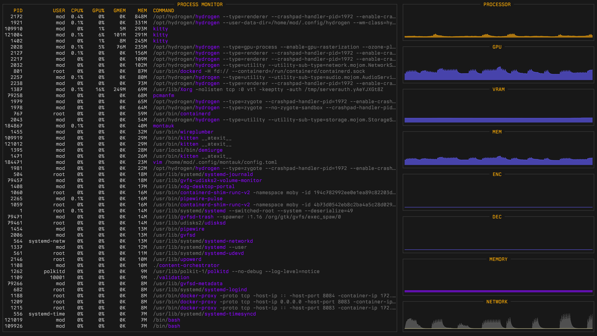
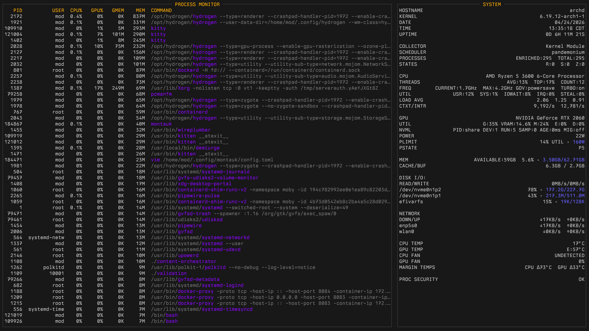
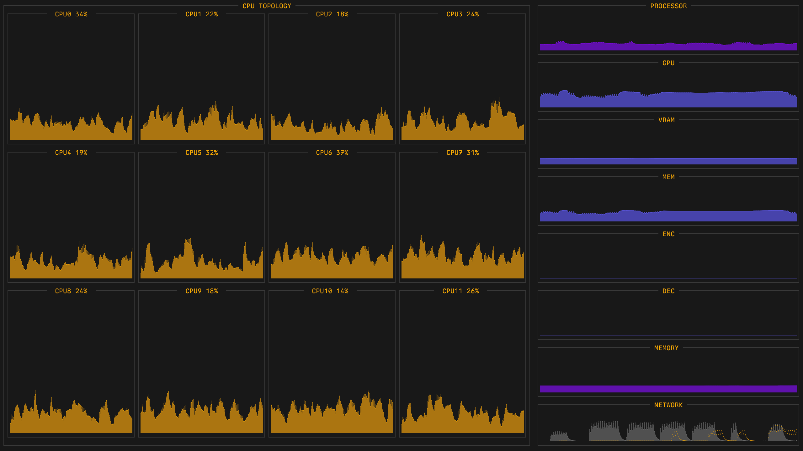

<p align="center">
  
</p>

## montauk

montauk is a Linux observability platform in one C++23 binary: An event-driven system monitor, an eBPF flight recorder, an offline analyzer and a static source reader, built on sublimation, its in-tree sort, search and learn core.

The system monitor attributes CPU, multi-vendor GPU, thermal, PMU cost to individual processes in real time and renders area charts over the Kitty graphics protocol. The tracer (`--trace`) is an eBPF flight recorder over a whole process tree, event-driven discovery with no ptrace: Per-thread syscalls and scheduler decisions with wake-to-run latency, sync-object contention, heap traffic, signals, file I/O and hardware counters through `perf_event_open`, at near-zero overhead into a binary log. The analyzer (`montauk --analyze` / `montauk --decode`) folds a 450 MB capture once into 30 single-pass diagnostic reports and cross-run population statistics, no live target and no privileges.

Every surface, the TUI, the Prometheus endpoint and structured JSON, renders from one typed result, provably consistent: A script or an agent reads exactly the data the human report shows. That result is enriched, not just measured: The classical-ML core scores each process for anomaly on the live snapshot, and montauk answers the question directly -- `--anomalies`, `--similar`, `--regime`, `--analyze DIR --digest` return conclusions rather than metrics.

The kernel module (`montauk-kernel`) and the external-metrics provider sockets are the only seams to the outside; everything else is one C++23 binary.

**sublimation** is montauk's in-tree, adaptive sort, search and learn core: A disorder-classified sort that measures what structure an input already carries (runs, rotation, sampled inversions, a distinct-value estimate, the phase boundary, the Young-tableau shape via patience sorting) and routes every input to the algorithm its structure earns, from a no-op through an O(n) reverse, counting sort, the spectral-merge run tree, a rotation fix and binary insertion, and a distribution radix for random data. Beside the sort is a text-matching engine with three faces (literal, regex, fuzzy k-mismatch), dispatched by pattern shape. Alongside search and sort is the classical-ML core: Three lanes of pure-algorithm learning (anomaly detectors, a graph-spectral engine, an FFT/signal-residual lane) with zero downloaded weights that turn telemetry into conclusions. The process table's ordering, the analyzer's rankers, the latency-structure classification its reports read and all of montauk's text matching run through it; the `sublimation` CLI exposes the same engine as a shell command with grep-exact exit codes.

## Screenshots

### Main Interface


Default view. PROCESS MONITOR on the left; pixel-rendered area charts (PROCESSOR, GPU, VRAM, GPU MEM, ENC, DEC, MEMORY, NETWORK) stacked on the right. Charts emit through Kitty's `t=t` /dev/shm transport (Sixel fallback) and update at 1 Hz over a 60-second rolling window.

### SYSTEM Focus (`s`)


`s` swaps the right-column chart stack for a text panel: Identity (hostname, kernel, uptime), runtime (collector, scheduler, process states), CPU (model, threads, freq/governor, load avg, ctxt-sw rate), GPU (model, util, NVML, power, p-state), memory, disk I/O, network, thermal margins and process-security findings, severity-colored in place.

### CPU Topology (`Shift+C`)


`Shift+C` swaps PROCESS MONITOR for a dynamic grid of bordered boxes, one per logical CPU, each rendering a pixel-rasterized area chart of that core's recent utilization (60s default, `[chart] history_seconds`) with live util% centered on the top border. Grid columns auto-fit the rect; high-core-count systems fall into scroll mode at minimum cell height. Same monotone-cubic AA rasterizer and Kitty/Sixel emit path as the right-column charts; the right column is unaffected by the toggle.

## Components

| Tool | Invocation | Role |
|---|---|---|
| **monitor** | `montauk` | Event-driven TUI. Per-process CPU and multi-vendor GPU attribution (NVIDIA NVML + `nvidia-smi` fallbacks, AMD sysfs, Intel fdinfo), thermal margins, security findings and a live case-insensitive process filter on sublimation's literal face. Cell-clipped UI, pixel-rendered area charts (Kitty `t=t` /dev/shm transport, Sixel fallback), three column-swappable views. Optional Prometheus `/metrics` over io_uring, hourly `.prom` logging and a one-shot `--json` snapshot. |
| **tracer** | `montauk --trace PATTERN` | eBPF flight recorder over a whole process tree: Event-driven discovery, no ptrace, no `/proc`. Per-thread state and syscalls, ntsync / futex / keyed-event sync, heap traffic, signals and aborts, file I/O, file-backed mmap, scheduler decisions with wake-to-run latency, CCX-bucketed migrations and hardware PMU counters via `perf_event_open`. Composes with `--metrics`, `--log` and a near-zero-overhead binary log (`--trace-out`). |
| **analyzer** | `montauk --analyze`, `montauk --decode` | Folds a capture once into single-pass diagnostic reports (30 of them, from `waits` and `doublefree` to `dispatch-stall` and `matrix-profile`) over logs reaching 450 MB+, plus recording-directory digests and cross-run population statistics. No live target, no privileges. Both are mode words of the one binary; the historical `montauk_analyze` and `montauk_trace_decode` executables are gone. |
| **static reader** | `montauk --static FILE\|DIR...` | Reads SOURCE rather than a capture and records every branch a program declares with the chain of conditions that must hold to reach it. A producer, not a second analyzer: It concludes nothing, and `montauk --analyze OUT.guards` reads the artifact through the same report, `--json` and gauge surfaces as a trace. Where the other three answer what a program DID, this answers what it COULD do. It also records what each file declares (functions, enumerators and macros) and every place a declared name is named again, and the analyzer walks those from the entry points -- `main`, anything named from file scope, a function a section, the runtime or a test runner enters (`#[test]`, a unittest TestCase's methods, pytest's `test*`), a callback a macro declares by the name a struct_ops table gives it -- to report the declarations no walk reaches, so a helper called only by dead code reads as dead too. A function with no branches emits no guard, but its declaration and graph are recorded like any other. Each function's control flow graph rides beside the guards, and the analyzer reports its cyclomatic complexity, the blocks nothing reaches from entry, dominator depth and natural against irreducible loops, and names the functions most nearly two functions: Each one's seam is the least-conductance cut over its Fiedler vector, from sublimation's spectral lane. A lexer, not a parser, so it carries no compiler dependency and macros stay unexpanded (guards diff across versions by the name they were written with). C, C++, Rust and Python; the scanner is one engine and a dialect is a table, and Python's indentation is rewritten into the engine's brace grammar with every line kept in place. A compiled BPF, aarch64 or x86-64 object takes the object lane: The same records from its instructions after optimization, each conditional branch a guard and each call, tail call, BPF map load and function address taken by code or data a reference, which the source lane cannot see. |
| **sublimation** | `sublimation` CLI + in-tree core  | montauk's sort, search and match core, used everywhere: The process table, every ordering the analyzer emits, the structure classification its reports read and all of montauk's text matching. The CLI exposes the same engine as a complete stream-processing surface: Statistics, structure, text and relational operations, with grep-exact exit codes. |

## sublimation: An adaptive sort, search and learn core

**sort core** The sort is a disorder classifier standing in front of six algorithms. One O(n) pass reads how much order an input already carries — run count, monotone runs, descent gaps — and the verdict picks the algorithm that order earns. Sorted input costs a scan. Reversed input costs a reverse. Few-unique goes to a counting sort, rotated data to an O(n) rotation fix, low-displacement data to binary insertion. Past those sit the two poles. Structured data takes a natural-run merge that closes with a spectral merge: Run joins ordered by effective resistance on the run-boundary path Laplacian, so the cheapest joins happen while the data is still hot. Random data takes a distribution radix — a tuned LSD with a combined-histogram scan, a write-combining scatter and a constant-byte skip — because once no order survives, comparison has no edge left to exploit. Equal keys never move, held by a packed-index tiebreak. Type-generic across i32/i64/u32/u64/f32/f64, and at scale both poles fork onto one Chase-Lev work-stealing deque, each at a threshold that was measured rather than assumed.

**search core** The matcher is one engine wearing three faces, and the pattern picks which. The regex face is a Glushkov position-NFA compiled into a bitset field. Thompson's construction — the one this replaced in v8.0.0 — burns its time on epsilon-transitions and a closure computation over a live state set; Glushkov's is epsilon-free, so every state is a position in the pattern, the whole transition function precomputes into one bitmask per input byte, and a match step is a shift and an AND. Nothing backtracks, so a pathological pattern cannot blow up — runtime is linear in the input, always. The field is one 64-bit word and **widens to two when the pattern earns it**, the same adaptive move the sort makes routing an input to the pole its structure earns — except the classifier here is exact, because the parser is the position counter and the width is known before the field is built. The narrow path is unchanged, scalar registers and no loop; the wide one lifts the budget to 128 positions. A bounded repeat of one class or byte (`[^]]{0,126}`) costs one position and a counter rather than a position per copy. Past that a pattern is rejected outright instead of quietly degrading, and a long alternation still splits into its branches. Above the field runs a prefilter ladder — a required literal, then a class field, then the alternation branches — each rung anchored on the rarest byte as measured in the data at hand, never a fixed English frequency table. The literal face is that anchor alone. The fuzzy face matches within N substitutions behind a pigeonhole prefilter, something no standard library ships.

**classical-ML core** The learn core is three lanes of classical machine learning with nothing to download: No weights, no training step, no model file. The learn lane ranks every process in the live table — the full population, not a top-N sample — on three detectors chosen to be blind in different directions. MAD modified z-score catches one axis gone extreme. Mahalanobis, through a Cholesky, catches an odd combination of individually ordinary axes. Half-Space Trees catch density with no assumption about shape. They combine by rank rather than raw score, which is the only reason detectors on unrelated scales can be added at all. The spectral lane answers what behaves like this one: Effective resistance through the Laplacian pseudoinverse, a commute-time distance that counts every path between two processes instead of the shortest, so many weak similarities outweigh a single fluke edge. The signal lane is an FFT carrying Spectral Residual — subtract the log-amplitude spectrum's own smoothed average and what remains is the part of the signal that fails to explain itself, which is where a regime shifts. Each lane comes out as a conclusion rather than a number: Anomalies, neighbors, regime shifts.

| Component | Function |
|---|---|
| **disorder classifier** | One O(n) pass → the verdict: `sorted` / `reversed` / `nearly-sorted` / `few-unique` / `phased` / `random`. The analyzer's `sched` report reads it to label a latency timeline's structure. |
| **run-merge tree** | Merges structured runs smallest-boundary-gap-first through a union-find, so the cheapest joins happen while the data is hottest |
| **index sorts** | order a `uint32_t` index array by a numeric key without moving rows (32-bit key packed with its index into one `uint64_t` and sorted adaptively; 64-bit key carried as a satellite, classified and routed to the radix or the spectral merge like the value sort) |
| **string sort** | prefix-pack + MSD-radix, for the process-name column and the CLI's whole-line text order |
| **structural locator** | slides the classifier across a stream to find *where* a disorder pattern sits (`locate`) |
| **randomness battery** | eight entropy lenses (hook-length entropy, LIS vs `2√n`, inversion ratio, distinct ratio, horizontal-visibility degree, ordinal permutation entropy, RQA determinism, spectral flatness on the comparison Laplacian) fused as confidence = (1 − 2⁻ᵏ) × meet, with a typed verdict: Max-entropy / consistent / mixed / structured (`rand`). RQA catches deterministic chaos (the logistic map) that every counting and ordinal lens reads as random. |
| **matcher** | text search, one engine, three faces: Literal (Boyer-Moore-Horspool, or one or two data-relative rare-byte anchors, picked from the data's own byte frequencies), regex (Glushkov bit-parallel field + reach-closure memo + literal prefilter), fuzzy k-mismatch (pigeonhole prefilter). Pattern shape picks the face. Backs `search` and all of montauk's text matching. |
| **value search** | `select` (quickselect) and `searchsorted` (binary, lower/upper bound) |
| **field** | N-th delimited column projection, awk's `{print $N}` |
| **learn lane** | pure-algorithm, zero-weight anomaly detectors over a feature matrix: Robust MAD modified-z (with a mean-absolute-deviation fallback so a constant column does not go blind), EWMA residual, squared Mahalanobis through a  Cholesky and streaming Half-Space Trees. The three spatial detectors (MAD, Mahalanobis, Half-Space Trees) rank-average into the per-process anomaly score montauk enriches its snapshot with, over six features (cpu%, rss, gpu%, page-fault delta, thread count and involuntary context switches — the last being the axis that sees a process getting *preempted*, which none of the other five can) -- each a lens the others cannot see through, MAD per-axis, Mahalanobis for an odd combination, Half-Space Trees for density with no shape assumption; EWMA is the temporal lens, held for the changepoint axis. |
| **spectral lane** | a cyclic-Jacobi symmetric eigensolver, effective resistance (the commute-time graph distance) through the Laplacian pseudoinverse, the Fiedler value with a spectral-gap partition count and Ng-Jordan-Weiss spectral clustering over a  Lloyd k-means. Backs `montauk --similar`. |
| **signal lane** | a  radix-2 FFT and the Spectral Residual saliency detector built on it, a weight-free shape-anomaly detector over a time series. Backs `montauk --regime`. |

**sublimation CLI** enables the full engine to be utilized via the shell for endusers directly. Numeric commands read a value stream (`--field N` pulls a delimited column, folding in awk's extraction): Order and quantiles, k-th selection and value lookup, the reductions (`sum`/`mean`/`min`/`max`/`count`, `stdev`/`variance`), disorder classification, a randomness verdict and `characterize`, the structural verdict that names a stream's disorder class, its randomness and its exploitable structure. `search`, `field` and `where` are the line tools; `group` is datamash / SQL `GROUP BY`, `describe` the one-shot summary pandas' `.describe()` prints, with floor(q·n) quartiles, `histogram` the shape, `outliers` the robust Tukey-fence flag; `replace` is `sed s/pat/repl/g` on the same matcher, with `\1`..`\9` backreferences, `\0` for the whole match and `\\` for a literal backslash; `intersect`/`subtract`/`union`/`join` are the two-stream relational lane; `locate --values` is select-by-structure (keep the part of the stream that *is* sorted, random or phased); `search --lines A,B` is sed's line addressing (`sed -n 'A,Bp'`), applied before every other flag sees a line; `uniq`/`cut`/`column`/`tac`/`paste`/`head`/`tail` fill out coreutils and `distinct`/`tally` are `sort | uniq [-c]`.


Nothing requires the pipe to name `sublimation` outright: A few `~/.bashrc` wrapper functions can route the stream forms of `grep`, `sort`, `wc`, `awk`, `cut`, `tac`, `paste`, `sed`, `head`, `tail` and `datamash` to it, so `awk '{print $1,$3}'`, `cut -f2 -d,` or `sed 's/foo/X/g'` resolve to `field`, `cut` or `replace`. The awk language proper (`BEGIN`/`END`, `NF`/`NR`, variables, `printf`, control flow) stays awk's; the wrappers route only the byte-for-byte idioms and rely on sublimation's grep-exact exit codes to keep shell conditionals correct.

| Command | Operation |
|---|---|
| `sublimation sort [--desc] [--keyed]` | order ascending / descending: a stream of bare numbers numerically, any other stream as whole lines in byte order (`LC_ALL=C sort`), never cut to a leading parse; `-n` forces numeric and refuses a line that is not one. `--keyed` keeps the whole line, ordering by the key (`--field N`, or the whole line), coreutils' `sort -k` with stable ties. sort(1)'s spellings work too: `-k N` per key, `-t D` and `-r` |
| `sublimation quantile Q [--nearest]` | the Q-quantile (Q in 0..1), the element at floor(q·n) and never interpolated; `--nearest` for the nearest-rank order statistic; `group KEY median` is the interpolated median |
| `sublimation select K` | the K-th smallest (0-based) |
| `sublimation searchsorted V` | insertion index of V in the sorted input |
| `sublimation sum \| mean \| min \| max` | reductions over the value stream, awk's `{s+=$N}` family |
| `sublimation stdev \| variance` | sample (n−1) standard deviation / variance |
| `sublimation count [--words\|--bytes]` | line / word / byte count, `wc -l/-w/-c` |
| `sublimation head N [FILE..]` / `tail N [FILE..]` | first / last N lines of each, with GNU's `==> FILE <==` header past one FILE; `-n N` and `-N` as head(1) spells them |
| `sublimation describe \| histogram \| outliers` | count, mean, stdev, min, floor(q·n) quartiles and max; 10-bin text histogram; Tukey-fence outliers |
| `sublimation classify` | disorder class + profile of the stream |
| `sublimation locate CLASS [--values]` | the windows where a disorder pattern sits; `--values` emits the data in them |
| `sublimation rand` | randomness confidence from the eight-lens battery |
| `sublimation characterize` | the structural verdict: Disorder class, randomness confidence, sort efficiency |
| `sublimation search PATTERN [FILE..]` | matching lines from stdin or files; regex by default, `-F` fixed string, `-k N` fuzzy k-mismatch. Bracket expressions take the twelve POSIX classes (`[[:alpha:]]`, `[[:digit:]]`, …), ASCII/LC_ALL=C like `\w` and `\s`; an unknown class name is rejected as grep rejects it |
| `sublimation search --lines A,B [FILE..]` | an absolute line window, `sed -n 'A,Bp'`; `A,` / `,B` / `N` for open ends or one line, and with no `-e`/`-f` the positionals are files and the whole window prints |
| `sublimation replace PAT REPL` | global per-line regex substitution, `sed s/pat/repl/g` |
| `sublimation field N,M [--delim D]` | the N-th column, or a comma-list, awk's `{print $N}` and `{print $1,$3}` |
| `sublimation where 'N OP V'` | lines whose field N satisfies the numeric predicate, awk's `$N OP V` |
| `sublimation group KEY OP [VAL]` | group by field KEY, aggregate field VAL — `sum`/`mean`/`count`/`min`/`max`/`sstdev`/`pstdev`/`first`/`last`/`median`/`mode`/`antimode`/`unique`/`collapse`/`countunique`, byte-verified against datamash `-g` |
| `sublimation search --dispersion PAT` | the *shape* of where a pattern falls: density, stride spread, burstiness, gap disorder class, spectral saliency, matrix-profile discord |
| `sublimation uniq \| cut \| column \| tac \| paste -s` | the coreutils line idioms |
| `sublimation distinct [--list] \| tally` | distinct-token count (`--list`: the tokens, first-seen order) / per-token frequency, `sort \| uniq [-c]` |
| `sublimation intersect \| subtract \| union \| join` | the two-stream relational lane |
| `sublimation comm FILE` | sorted three-column compare against stdin, comm(1) |
| `sublimation diff FILE` | line edit from FILE to stdin; exits as diff(1) does, 0 same, 1 different, 2 trouble -- the one verb outside the grep contract |
| `sublimation tee [-a] [FILE..]` | coreutils tee, zero-copy through tee(2)/splice(2) when stdin and stdout are pipes |
| `sublimation tr SET1 SET2` / `tr -d SET1` | translate or delete characters, tr(1), with X-Y ranges |
| `--records-out` / `--records-in` | typed f64 records between two value verbs instead of text: `sort`, `outliers` and `locate --values` emit them, every value verb reads them, with no per-value format or parse |
| `--json` | `describe`, `histogram`, `classify`, `locate`, `rand` and `characterize` print one JSON object instead of their text report: `schema_version`, `verb`, `n` and `skipped`, then every figure the text shows, exact (histogram edges unrounded), with `null` for a measure that was not taken and the class spelled as `locate` takes it |

`search` carries the full grep working set: `-F`/`-E`/`-k N` pick the face, `-i` and `-S` (smart case) handle casing, `-v`/`-c`/`-n`/`-o`/`-q`/`-m N` shape output, `--confuse 'f=ſ,c=e,rn=m'` makes substitutions inside declared classes free on `-F` and `-k N` (for OCR, whose errors come in known pairs), `-A`/`-B`/`-C` add context, `-w`/`-x` anchor to words or whole lines, `-e PAT` (or `--regexp PAT`, a pattern whatever it looks like)/`-f FILE` build multi-pattern sets, `-l`/`-L` name files with or without a match, `-H`/`-h`/`--label` control the filename prefix, `-s` silences unreadable-file messages, `-a`/`-I` set binary-file handling, `--color=auto|always|never` highlights, `--line-buffered` flushes per line, `-r` walks each directory operand as `grep -r` does (depth-first in readdir order, a symlink followed only when named, `.` when nothing is) and `--files-from LIST` reads input paths from a list (`find ... -print0 | sublimation search PAT --files-from -`); without `-r` a directory is refused, as grep refuses it. Exit codes are grep's contract exactly: 0 matched, 1 nothing, 2 unreadable input. The whole surface is byte-verified against GNU grep and coreutils in a 170-case parity gate plus an exit-code oracle.

**`search --dispersion` is montauk's first text sensor.** Every other sensor reads structured telemetry — CPU, GPU, thermal, PMU, sched — so "where does this pattern cluster in this log, and does its burst line up with something else that moved" had no answer, which left grep the last metric-not-conclusion tool in the box. The instruments run over the **sparse match positions**, never the haystack: the matcher skips billions of bytes, the instruments relate a few thousand arrivals. That is the separation law resolved rather than bent — the relate-shaped primitives that keep being proposed *inside* the matcher belong above it, on its output. Burstiness is the Goh-Barabási coefficient, scale-free by construction so a dense pattern and a rare one compare directly: validated at −0.913 for strictly periodic arrivals, −0.022 for a memoryless 5%-per-line pattern and +0.877 for one confined to three windows, with the disorder classifier agreeing independently.

**`-i` folds beyond ASCII, and agrees with `grep -i` exactly.** Two characters fold together when glibc agrees on **both** `towlower` and `towupper` — grep's own rule, and the only one that reproduces it. Weaker rules overmatch and were each caught against the oracle: the transitive closure of the two mappings drags the historic Cyrillic letters into the ordinary class, keying on `towlower` alone still equates U+212A KELVIN SIGN with `k`, and `str.casefold()` is broader than either. Deriving the table from Python instead of glibc was wrong in both directions at once.

Mechanically there are two cases. Where the two UTF-8 encodings share a lead byte, the fold is one position with two byte members — free. Where they differ earlier, or in **length**, one position sequence cannot hold both without also accepting the crossings (an upper lead byte with a lower tail, decoding to a character nobody wrote), so those become an **alternation per character**: correctness bought with positions, which is what the field's second width is for. Case mapping is also not a bijection — U+03A6 capital phi, U+03C6 small phi and U+03D5 phi symbol are one class of three — so the table holds classes, not pairs.

Nothing narrows any more: `-i` matches exactly what it implies, Cyrillic `москва` matches `МОСКВА`, and the notice that used to warn about unfoldable characters is gone with the gap it reported. Verified against `grep -i` rather than by eye: 0 mismatches over 1,415 checks across 704 fold classes, every multi-member class included. The table is generated from glibc (`sublimation/tools/genfold.c`), never hand-written — an earlier hand-rolled version was wrong in 20 of 242 cases in a single block.

For example: `cat dump | sublimation quantile 0.99 --field 2` for a column's 99th percentile, `ps aux | sublimation where '6 > 100000'` to keep the heavy processes, `seq 1 1000 | shuf | sublimation characterize` to name a stream's shape. The division is by **target**: sublimation owns the stream (the column, filter, reduce, order and structure idioms) and a search over a tree, while `find` keeps filesystem traversal for everything else and `awk` keeps the awk language itself.

**Performance**

AMD Ryzen 5 3600, Zen 2, `-O2 -march=native`, ns/element, best of 5; the harness is in-tree at `sublimation/tests/bench/`, each language sorting the same seeded data with its own standard library: C `qsort`, an inline introsort, Rust `slice::sort_unstable` (ipnsort), Go `slices.Sort` and Python `sorted`. Keys are full-width — a narrower fill leaves the top bytes of a 64-bit key constant, which gives a radix a free pass skip that a comparison sort never gets.

**Structured Sort Performance** (n = 100K)

Where the adaptive routing pays: The sort reads the order an input already carries instead of rebuilding it, so a comparison sort's O(n log n) is work it never does.

| Pattern | sublimation | Rust | Go | introsort | qsort | Python |
|---|--:|--:|--:|--:|--:|--:|
| sorted | **0.1** | 0.2 | 0.5 | 4.6 | 21.8 | 3.3 |
| equal | **0.1** | 0.3 | 0.5 | 8.5 | 22.8 | 2.6 |
| reversed | 0.5 | **0.4** | 0.8 | 5.2 | 31.0 | 5.2 |
| pipe-organ | **2.9** | 17.5 | 23.1 | 51.0 | 26.6 | 7.9 |
| nearly-sorted | 10.3 | 15.9 | 13.8 | **8.0** | 39.9 | 17.1 |
| few-unique | 13.7 | **2.2** | 8.3 | 17.6 | 53.7 | 57.2 |
| phased | 35.3 | **13.2** | 30.0 | 51.2 | 102.0 | 37.3 |
| random | 33.0 | **16.0** | 66.0 | 48.9 | 96.3 | 127.6 |

Sorted and equal input costs a scan, and pipe-organ — one ascending run and one descending — is read as two runs and merged rather than partitioned, which is where the run-merge tree earns its keep. The honest losses are also here: Rust's pdqsort has a dedicated equal-elements partition that beats the counting sort on few-unique, and introsort wins nearly-sorted at this size.

**Random Sort Performance**

Where there is no structure to exploit, so the radix competes head-on with tuned in-place comparison sorts.

| n | sublimation | Rust pdqsort | Go | introsort | qsort | Python |
|---|--:|--:|--:|--:|--:|--:|
| 100K | 33.0 | **16.0** | 66.0 | 48.9 | 96.3 | 127.6 |
| 1M | **15.6** | 18.1 | 77.8 | 61.6 | 122.8 | 215.5 |
| 10M | **15.6** | 20.6 | 89.5 | 68.9 | 139.7 | 348.8 |
| 100M | **16.0** | 23.2 | 101.6 | 78.9 | 162.0 | 510.1 |

Below the parallel threshold the radix is a serial LSD and Rust's pdqsort wins outright at 100K. From 1M up both poles fork onto the work-stealing deque and sublimation takes the lead, holding flat at 15.6-16.0 ns/element from 1M through 100M while every comparison sort degrades as the working set leaves cache — the crossover the thresholds exist to find. The margin widens with n: 1.2x over Rust at 1M, 1.5x at 100M; against C's `qsort` 8-10x, against Go 5-6x, against Python 14-32x.

**Search Performance**

AMD Ryzen 5 3600, Zen 2, MB/s on 4 MB corpora, higher is better. The harness is in-tree at `sublimation/tests/search/bench/`: Seeded deterministic corpora, median-of-9, with C, C++, Go, Rust-std and Rust-regex comparators, byte-parity-gated against Python `re`, a brute k-mismatch oracle and a position checksum. The regex face against the Rust `regex` crate (ripgrep's engine, SIMD Teddy + lazy DFA) and Go `regexp` (RE2 lineage):

| Pattern | corpus | sublimation | Rust regex crate | Go regexp |
|---|---|--:|--:|--:|
| `A[CG]TT` | DNA | **273** | 234 | 39 |
| `str[a-z]ct` | source | 1.6k | 4.7k | 484 |
| `MARK[A-Z]R` | repetitive | 26.7k | 56.9k | 52.7k |

A scalar bit-parallel field, measured against a SIMD one. It wins where the pattern is dense and literal-poor and the reach-closure memo does the work (`A[CG]TT`, ahead of every engine measured and 7x Go). It loses where a literal prefilter is the whole game and Rust's is vectorized: `str[a-z]ct` by 2.9x and `MARK[A-Z]R` by 2.1x. That is the one standing gap and it is a stated non-goal — Teddy/FDR-class multi-literal SIMD is deliberately not built, because chasing grep's throughput is not what sublimation is for. Against Python `re`, C++ `std::regex` and POSIX the margin is 3-500x on every pattern. **Fuzzy k-mismatch is a face no standard library ships at all**: `SIGKILL` k=1 at 8.8k MB/s, with no competitor to put in the column.

**Build.** Compiled as a static library with montauk, `-march=native` for the build host, so a binary runs on the CPU family it was built for. The AVX2 sorting networks and classifier lane compile in where the host has AVX2; scalar paths serve where it does not. gcc 13+ (C23).

**Where montauk uses it:** The process-table sort and the analyzer's orderings (latency quantiles, report rows, struct-by-key sorts via `sublimation_order_*`, value lookups via `searchsorted`); the `sched` report's structure classification and locator; and all of montauk's text matching (kernel-thread classification, the live `/`-search, `--trace` token matching). montauk's C++ carries zero `std::sort`, `std::stable_sort` or `std::nth_element` call sites; every ordering routes through sublimation.

## montauk's CLI Operating Modes

montauk composes its modes from CLI flags:

| Command | Operation |
|---|---|
| `montauk` | TUI only |
| `montauk --log /var/log/montauk` | TUI + Prometheus-format log files |
| `montauk --log /var/log/montauk --log-interval-ms 5000` | Custom write interval (default: 1000ms) |
| `montauk --metrics 9101` | TUI + Prometheus endpoint on :9101 |
| `montauk --headless --metrics 9101` | Daemon mode: Prometheus only, no TUI |
| `montauk --headless --metrics 9101 --log /var/log/montauk` | Daemon mode: both |
| `montauk --headless --log /var/log/montauk` | Daemon mode: logging only |
| `montauk --headless` | Error: requires --metrics or --log |
| `montauk --trace firefox` | Trace mode: per-thread diagnostics for process group |
| `montauk --trace APP --metrics 9101` | Trace mode + Prometheus endpoint |
| `montauk --trace APP --log /tmp/trace` | Trace mode + flight recorder |
| `montauk --trace APP --trace-out FILE.bin` | Trace mode + raw binary event log |
| `montauk --trace APP --trace-ring-bytes 64M` | Size the BPF ring (K/M/G; default 1M) |
| `montauk --trace APP --trace-classes sched,exec` | Capture only the named event classes |
| `montauk --trace APP --trace-syscalls readlink,readlinkat` | A record per call: arguments, result, duration, return address, its mapping and the paths it names |
| `montauk --trace APP --trace-syscalls-from anon` | Only the calls made from memory no file backs: code mapped by hand, a JIT's |
| `montauk --trace APP --sched-detail` | Add the per-switch scheduler stream the placement, slice and stall reports need |
| `montauk --trace APP --stream-out /dev/ttyS1` | Second binary stream to a character device |
| `montauk --json` | One-shot structured system snapshot (JSON), then exit. |
| `montauk --anomalies 5` | Rank what is anomalous right now, with the dominant axis |
| `montauk --similar PID` | Processes behaving like PID (`--similar-top N` for how many) |
| `montauk --regime 64` | Did the load regime shift recently, and when |
| `montauk --cpu-window 64` | Sample aggregate CPU N times, emit the series |
| `montauk --pmu-comm SUBSTR` | Attach per-process hardware counters (no root, no sysctl) |
| `montauk --pmu-pid N` | The same for one explicit pid (repeatable; composes with `--pmu-comm`) |
| `montauk --decode FILE.bin` | Decode a binary log to text (--csv for CSV) |
| `montauk --analyze FILE.bin --json`  | Emit the diagnostic reports as one JSON envelope. |
| `montauk --analyze FILE.bin --json-out FILE.json` | The text report, and the envelope to FILE.json, from one pass |
| `montauk --analyze FILE.bin --report waits` | Run an analysis report over a binary log |
| `montauk --analyze FILE.bin --select sched.kick_issue --pair resched --by cpu --stats p50,p99` | Ask a question no report answers: select, key, one operator |
| `montauk --analyze FILE.bin --select syscall --where path~/proc/ --between 256ms:1095ms` | Calls naming a path, in a window from the capture's start |
| `montauk --analyze RECORDING_DIR --digest` | One-call shareable digest over a whole recording |
| `montauk --analyze RECORDING_DIR --l2-by-cpu` | Localize L2 misses per CPU over the busy window |
| `montauk --analyze DIR --by LABEL` | Population statistics across many runs (`--json` for the envelope) |
| `montauk --analyze DIR --by capture --relative-to scheduler=EEVDF` | Each cell as a ratio to its own capture's control cell, so box drift divides out |
| `montauk --analyze DIR --by version --alias-label tool:old=new` | Pair a label value a producer renamed between releases |
| `montauk --static DIR -o OUT.guards` | Record every branch, declaration and control flow graph a source tree or object declares |
| `montauk --analyze OUT.guards` | Read a `.guards` artifact: guards, unreached declarations, complexity and seams |
| `montauk --init-theme` | Detect terminal palette, write config.toml |
| `montauk --iterations N` | Render N frames then exit (scripting and self-test) |
| `montauk --self-test-seconds S` | Run S seconds, then print the publish rate and the producer's CPU by stage |

**Live output.** `--metrics PORT` serves Prometheus exposition (0.0.4) at `/metrics` over io_uring — about 60 `montauk_` families across CPU, memory, network, disk, filesystems, process states, per-process top-N and per-device GPU. `--log DIR` writes the same text to disk, rotating hourly as `montauk_YYYY-MM-DD_HH.prom`. Both read the TUI's own lock-free buffers and compose with each other and with `--trace`.

**Structured JSON.** `montauk --json` prints one live snapshot and exits (two producer cycles warmed first, so rate deltas are real); with `--trace` a second JSON-lines record carries the trace snapshot. `montauk --analyze FILE --json` emits the reports as one envelope, and `--json-out FILE` writes that envelope beside the text report from the same pass; population mode takes `--json` too. JSON is a renderer over the same typed result as text and Prometheus — montauk writes JSON, never parses it.

**Conclusions, not payloads.** Four modes answer a question directly instead of returning the state to derive it from — `--anomalies N` ranks the fused anomaly score montauk already computes, naming each process's dominant axis; `--similar PID` returns effective-resistance nearest neighbours over a self-tuning affinity graph of the live population; `--regime N` runs a spectral residual over a sampled CPU window and reports whether load shifted and when; and `montauk --analyze DIR --digest` does the same for a recording. They exist because the answer is small and the state is not: `--anomalies` costs about 600 bytes where the snapshot it derives from costs 67,000. `--similar` collapses identical feature vectors before solving, since a process table is mostly idle duplicates and an uncollapsed graph returns the same resistance for every one of them; the reply carries `identical_peers` and the true `graph_nodes` count. `--cpu-window N` exposes the raw sampled series when the window itself is wanted rather than a verdict.

**Trace mode.** `--trace PATTERN` runs headless, attaching BPF to scheduler, syscall, signal and fd/mmap tracepoints plus libc uprobes; no `/proc` scanning after attach. Matching is in-kernel at exec, first syscall, `prctl(PR_SET_NAME)` and fork, so thread pools, container runtimes and self-renaming daemons are caught and children auto-track. Captures per-thread state, syscalls with decoded arguments, on-CPU time, fds, file I/O, futexes, heap traffic, signals with stack snapshots, mmap, scheduler decisions, per-CCX migrations and ntsync. `--sched-detail` adds the per-switch stream the placement, slice and stall reports need (~6x cost). Requires root.

**Capture sizing.** `--trace-ring-bytes N` (K/M/G) sizes the BPF ring: on one workload the 1M default dropped 46,214 events where 64M dropped zero. `--trace-classes LIST` mutes classes so a loud one cannot drown the one being captured; an excluded class is not counted as a drop, and a probe that feeds only excluded classes is never attached, so a capture without heap pays nothing for the allocator probes. Every event type rides a class: ntsync and futex carry their wait-site stacks, comm the thread names, sched the kernel strands and storm counters.

**The syscall class.** Opt-in, since it is a record per call: `--trace-syscalls LIST` (names or numbers) or `--trace-syscalls-from anon` asks for it, and every other class is captured without it. Each record carries the call's number, its six arguments, its result (a negative errno on failure), its duration, the address it returns to and the mapping holding that address, flagged when no file backs it, plus the paths a path-taking call names: openat's, both of rename's, and the target readlink and readlinkat returned. Both filters run in the kernel before a record exists, so a call left out costs no ring space; `--trace-syscalls-from anon` keeps only calls made from memory no file backs, which is where code mapped by hand runs, so a call whose number is not known yet can still be found. Exec records carry the parent at exec time, the whole filename and the argument vector, and fork and exit records their time; `--trace-path-bytes N` bounds each string (default 256). The mmap class keeps an anonymous mapping made executable beside the file-backed ones. A signal row carries its disposition (default, caught or ignored, the last stamped where the kernel drops it) and the pid that sent it, the shutdown signals (SIGHUP, SIGINT, SIGQUIT, SIGTERM) beside the fatal ones; a delivery also carries the interrupted registers and the top 4 KB of the user stack, which the `signals` report walks by the `.eh_frame` of the files the capture's maps sidecar names, so a site reaches through code built without frame pointers. `--trace-out FILE` writes raw records in ~256 KB batches with monotonic/realtime anchors; `--stream-out DEVICE` mirrors to a character device so a capture survives a filesystem hang.

**Offline analysis.** The analyzer and the decoder are modes of montauk itself, not separate executables. The old `montauk_analyze` and `montauk_trace_decode` names are gone -- not renamed, not symlinked. `montauk --decode FILE.bin` renders a text event stream (`--csv` for CSV). `montauk --analyze` runs single-pass reports, each folding the file once, narrowed by `--sig`, `--comm`, `--pid`, `--tid` or `--window`: `summary`; sync (`waits`, `spins`, `pairing`, `endstate`, `futex`, `keyedevt`); heap (`heapstk`, `doublefree`, `abortpm`); `signals`; I/O (`iolat`, `iowait`); scheduler (`sched`, `slice`, `service`, `wakers`, `seat`, `work-conservation`, `placement-race`, `dsq-placement`, `dispatch-stall`, `kick-latency`, `storm`, `kstrand`, `locality`, `classmix`, `field-persist`, `fractal`); and `matrix-profile`, the unsupervised lens that names a run's most anomalous window and its most recurring pattern without being told what to look for. Over a recording directory: `--digest [--redact]`, `--l2-by-cpu`, `--by LABEL`. Every report is a saved query over the trace, and a question nobody has saved is a command line rather than new code: `--select CLASS[.OP,...]` picks events, `--where FIELD<op>VALUE` narrows them on any field, `--by` keys them, and one operator answers -- the rows, `--count`, `--gap`, `--pair OP` or `--last` -- with `--stats` reducing the result and `--json` for an agent.

**Hardware counters.** Trace mode samples per-CPU L2, instructions, cycles, context switches, migrations, branch misses and per-CCX L3 where available, as `montauk_pmu_*` rates plus cumulative `_total`s, alongside RAPL power/energy, frequency, idle residency and energy-per-instruction. Needs `perf_event_paranoid <= 0` or `CAP_PERFMON`. **`--pmu-comm SUBSTR` / `--pmu-pid N` are the unprivileged half**, not gated behind trace mode: they open at the ordinary paranoid of 2 and attach instructions, cycles, dTLB load misses and cache misses per matching process, re-resolved each tick. Whether kernel time is excluded is published (`montauk_pmu_per_process_user_only`).

**External providers.** `ProviderCollector` reads one Prometheus-text snapshot from each `<name>.sock` under `$XDG_RUNTIME_DIR/montauk/providers/` (fallback `/run/montauk/providers/`). Providers self-identify by filename; a missing directory is a silent no-op. Text passes through verbatim and embeds into the binary trace stream. Export-only.

## Installation

### Simple Install

```bash
./install.py
```

### Advanced Install (CMake)

```bash
cmake -B build -DCMAKE_BUILD_TYPE=Release
cmake --build build -j$(nproc)
sudo cmake --install build   # optional
```

liburing and NVML are detected by their headers at configure time, and libbpf with `bpftool` and `clang` to build the BPF object; all three are opened at run time, so one binary still runs on a box missing any of them (the bare-box gate holds that). Without liburing montauk builds with the Prometheus endpoint disabled, and without the eBPF toolchain without `--trace`.

### Other Commands

```bash
./install.py build         # Build only, don't install
./install.py clean         # Clean build directory
./install.py uninstall     # Remove the installed binary and kernel module
./install.py test          # Run the full suite (tests/run.py)
./install.py --no-kernel   # Skip the kernel module (built by default)
./install.py --no-bpf      # Build without eBPF trace (built by default)
./install.py --test        # Also build montauk_tests
./install.py --prefix /usr # Install prefix (default /usr/local)
./install.py --debug       # Debug build
```

### Arch Linux Package

```bash
makepkg -si   # From the PKGBUILD at the repo root
```

## Uninstall (CMake)

```bash
sudo xargs rm -v < build/install_manifest.txt
```

## Packaging (Arch Linux)

- PKGBUILD at the repo root; `makepkg -si` installs to `/usr/bin/montauk`
- Depends: `glibc`, `gcc-libs`, `libbpf`, `liburing`; build: `git`, `cmake`, `gcc`, `clang`
- Optional: `nvidia-utils` (NVML attribution), `linux-headers` (the kernel module, through `./install.py`)
- NVML detected at build time; the kernel module and tests are off in the package build

### TUI Process Collection

montauk auto-detects the best available backend, in this priority:

| backend | mechanism | requires | CPU overhead | event detection | syscalls per snapshot |
|---|---|---|---|---|---|
| **kernel module** | genetlink read of the in-kernel table; kprobes update it directly, workqueue refreshes CPU times at 1 Hz; zero `/proc` reads, zero netlink event traffic | `montauk.ko` loaded | ~0.1-0.2% | sub-millisecond | 1 |
| **netlink proc_connector** | fork/exec/exit events from the kernel, `/proc/[pid]/*` reads for details | `CAP_NET_ADMIN` | ~0.5-1% | sub-millisecond | ~1 + N events |
| **/proc polling** | scans `/proc` each cycle; identical functionality and UI | nothing | ~2-5% | ~1s | ~3 per process |

To enable netlink proc_connector when the kernel module isn't loaded:
```bash
sudo setcap cap_net_admin=ep /usr/local/bin/montauk
```

Force a backend for testing:
```bash
MONTAUK_COLLECTOR=kernel ./montauk       # requires montauk.ko
MONTAUK_COLLECTOR=netlink ./montauk      # requires the capability
MONTAUK_COLLECTOR=traditional ./montauk  # /proc polling
```

## TUI Controls

**Navigation:** `q` quits; `↑/↓` scrolls the process list; `PgUp/PgDn` pages.

**Search/Filter:** `/` enters live case-insensitive substring filtering; `Enter` confirms, `Esc` exits (or clears an active filter from normal mode); `Backspace` deletes (empty backspace exits).

**Sorting:** `c` CPU%, `m` Memory, `g` GPU%, `v` GPU Memory, `p` PID, `n` Name.

**Modes and toggles:**
- `s` toggles SYSTEM focus (right column: Chart stack ↔ text panel)
- `C` (Shift+C) toggles the CPU TOPOLOGY grid (left column; arrows and PageUp/PageDown scroll on high-core systems; `Esc` or `C` returns). The two column toggles are independent.
- `i` toggles CPU scale: Machine-share (100% = the whole machine, processes sum toward system usage) ↔ per-core IRIX-style (100% = one core, multi-threaded apps exceed 100%)
- `u` toggles GPU scale (capacity ↔ utilization)
- `G` toggles the GPU charts (util / VRAM / GPU MEM / ENC / DEC)
- `t` toggles the Thermal section inside SYSTEM focus
- `R` resets the UI; `+/-` adjusts the refresh rate

**Help overlay:** `?` or `h` opens it. The overlay loads `man montauk` at runtime and renders it inside the PROCESS MONITOR column, reflowing to the available width via `MANWIDTH`; edit `montauk.1` and the overlay updates on next open. While open: `j`/`k` scroll, `d`/`Space` page down, `u` page up, `g`/`G` jump, `q`/`?`/`Esc` close.

## Configuration

montauk reads a unified TOML file at `~/.config/montauk/config.toml`, resolving each value TOML → `MONTAUK_*` environment variable → compiled default; no file means compiled defaults at zero overhead. `montauk --init-theme` writes a starter with your terminal's 16-color palette detected. The full schema (`[palette]`, `[roles]`, `[thresholds]`, `[ui]`, `[process]`, `[nvidia]`, `[chart]`), the process-collector settings and the complete `MONTAUK_*` reference live in [`CONFIG.md`](CONFIG.md). The process columns, two-column layout and severity color coding are documented in [`CONFIG.md`](CONFIG.md#display-details).

## GPU Support

### NVIDIA

Full NVML integration (recommended): Per-process GPU utilization (SM, encoder, decoder), per-process VRAM, device-level metrics (util, power, temps, clocks), MIG detection and PRIME render offload. NVML support compiles in when the build host has `nvml.h` (the `cuda` headers; `/opt/cuda/include` on Arch). The library itself, `libnvidia-ml.so.1` from `nvidia-utils`, is opened at run time and held for the life of the process, so a box with no NVIDIA driver still runs montauk.

When NVML is unavailable or insufficient, montauk walks a fallback chain: Device-level `nvidia-smi --query-gpu=…`, `nvidia-smi pmon` per-process sampling, `nvidia-smi --query-compute-apps` for compute memory, `/proc/driver/nvidia/gpus/*/fb_memory_usage` for device VRAM, then heuristic distribution from device-level metrics.

### AMD/Intel

`/sys/class/drm` for VRAM, temperatures and power; `/proc/*/fdinfo` (DRM) for per-process utilization; `gpu_busy_percent` for device utilization.

### Browser GPU Process Detection

montauk identifies browser GPU processes (Chrome, Chromium, Helium, etc.) by scanning for `--type=gpu-process` in command lines, enriching up to 256 processes with full cmdline data, applying fallback attribution when processes use minimal CPU and inspecting `/proc/*/fd` device files for decode-only workloads.

### GPU Configuration

All GPU settings live under `[nvidia]` in TOML. Env var fallbacks:

```bash
MONTAUK_NVIDIA_PMON=0     # [nvidia] pmon = false
MONTAUK_NVIDIA_MEM=0      # [nvidia] mem = false
MONTAUK_LOG_NVML=1        # [nvidia] log_nvml = true
MONTAUK_NVIDIA_SMI_DEV=0  # [nvidia] smi_dev = false
MONTAUK_NVIDIA_SMI_PATH=… # [nvidia] smi_path = "…"
MONTAUK_SMI_MIN_INTERVAL_MS=1000  # [nvidia] smi_min_interval_ms = 1000
MONTAUK_GPU_DEBUG=1       # [nvidia] gpu_debug = true
MONTAUK_DISABLE_NVML=1    # [nvidia] disable_nvml = true
MONTAUK_NVML_PATH=…       # [nvidia] nvml_path = "…"
```

## Churn Handling

During heavy system activity (builds, installs, rapid process creation), `/proc` and `/sys` entries vanish between directory scans and file reads. This affects the userspace collectors; the kernel module is immune, since it reads `task_struct` directly. montauk absorbs churn without breaking: Churned processes may show partial metrics for one sample, then clear, and the system stays responsive throughout.

When churn is active, the SYSTEM box swaps PROC SECURITY for a PROC CHURN readout: A summary line (`PROC CHURN  N events [LAST 2s]`, colored as caution), a `PROC:X  SYSFS:Y` source breakdown and the affected PIDs (the event count can exceed the visible PIDs, since processes exit before the display updates). When churn subsides, PROC SECURITY returns automatically. Reproduce it with the stress script under [Testing](#testing).

## Testing

**Build with tests:**
```bash
cmake -S . -B build -DMONTAUK_BUILD_TESTS=ON
cmake --build build -j
./build/montauk_tests
```

`montauk_tests` includes the Prometheus serializer tests. sublimation's `test_json` checks the JSON writer both faces share byte for byte.

**One runner (`tests/run.py`, or `cmake --build build --target check`)** drives four layers: `unit` (montauk_tests, sublimation's C23 suite and the work-stealing engine, plain and under ASan, UBSan and TSan), `gate` (the Python proofs below), `perf` (CPU-time ceilings and growth bounds on the analyzer, the population mode, the regex face and the producer's collection cost, plus the CLI sort against `sort -n`) and `trace` (the live BPF harness; it needs root, and without it the layer reads SKIP, never PASS). The trace layer traces a workload by the second and third of three names, and holds small C programs it builds, each traced alone, to what they did: Every ntsync wait under its own thread, an aligned allocation that takes back a freed block reading as no double free while a real one is flagged, a thread's first free recorded once, a narrowed capture attaching no probe it does not read, the abort carrying the C library's text, a syscall made from a page mapped by hand recorded with the path it returned and the page it came from, and a rename, unlink and rmdir each naming the paths they removed. The gate layer's proofs:

- `corpus_check.py` checks the surfaces that can be WRONG rather than merely DIFFERENT over a deterministic synthetic capture: The analyzer and decoder exit clean, the `--json` envelope parses, every deterministic CLI case exits clean, tally and distinct survive the hash map's grow boundaries, and tally's tie order and format match the pipeline it is named after.
- `parity_check.py` runs 153 cases of sublimation verbs against the real coreutils and GNU grep on identical input (nine skip where datamash is absent) and fails on any byte divergence: The regression guard that keeps shell-wrapper routing safe.
- `pop_gate.py` pins the population mode: An injected +50% shift must be found (full-magnitude Cliff's delta at the boundary pair) and a stable family must yield no change point. A renamed label value read with `--alias-label` must match the archive written with the new value, a cell only one arm carries must print that arm's N and values, the `--json` envelope must carry what the text does, and `--relative-to` must divide each cell by its own capture's control and name a capture that has none.
- `semantic_check.py` rejects any emitted gauge family whose help text is a placeholder or an echo of its own name.
- `static_check.py` holds `montauk --static` to an independent Python implementation of the same scan on every guard, declaration, reference, block and edge, over montauk's own C++ and BPF C and a Rust corpus of fixtures; holds the Python reading to CPython's own parser over montauk's Python; holds the object lane's conditional branches to GNU objdump, function by function, over montauk's own x86-64 objects and libc; pins the graph of every construct on hand-checked C and Rust fixtures; and recomputes the analyzer's reachability, join and graph arithmetic from the artifact's own rows. A lexer fails by being confidently wrong, which no frozen expectation catches and two implementations disagreeing does.
- `query_check.py` holds the `--select` face to the fixture's known events, and `report_coverage_check.py` freezes which reports the fixture drives to a real conclusion, so coverage cannot drift silently.
- `abi_check.py` holds sublimation's public symbol set to its declared ABI number, `sort_ban_check.py` keeps every std, libc and kernel sort out of shipped code, `bare_box_check.py` proves the one binary execs without libbpf, liburing or NVML, and `install_manifest_check.py` derives uninstall from what install recorded.
- sublimation's public API against its oracles: The matcher against Python `re` and a brute k-mismatch over generated patterns, bounded repeats against `grep -E`, `--confuse` against its rewrite rule, the learn, spectral and signal lanes and the statistics against numpy and scipy, `tee` against coreutils, the f64 records against the text path, the report verbs' `--json` against their text, `sort` on text against a byte-order sort, the zero-width assertions refused by name, the estimator each value verb's help names, and the public headers compiled as C++.
- `gpu_stop_check.py` stops a headless GLES load it builds and holds every snapshot wholly inside the stop to 0% GPU, and the running load to attributed; on a box without an NVIDIA GPU read through NVML it reads SKIP.
- `tests/tui/interrupt_check.py` drives the real TUI on a pseudo-terminal and holds `^C` to a clean exit with nothing painted after the terminal is restored.

sublimation carries its own standalone suite under `sublimation/tests/` (843k checks green, ASan and TSan clean, with libc sorts surviving only as differential oracles) plus the search byte-parity oracle (Python `re`, brute k-mismatch, position checksum) and the in-tree sort and search benches.

**Self-test mode:** `./build/montauk --self-test-seconds 5` runs at a terminal for five seconds, then prints the publish rate and the producer's steady-state CPU stage by stage (each collector, GPU attribution, anomaly scoring and the rest) in ms/s and share.

**Churn stress:** `tests/proc_churn.py 3000 0.01` spawns 3,000 short-lived processes 10 ms apart, about 100 a second for 30 seconds, to exercise `/proc` resilience on the userspace collectors. Its three arguments are the count, the delay between spawns and each process's lifetime, in seconds. Watch it with montauk running (`s` for SYSTEM focus).

Tests are disabled by default in packaging builds (`MONTAUK_BUILD_TESTS=OFF`).

## Policy

Vendoring is enforced, not aspirational: CMake poisons `FetchContent_Declare` and `ExternalProject_Add` with `FATAL_ERROR` at configure time, so a third-party fetch cannot enter the build. NVML and liburing are auto-detected and gracefully disabled when unavailable.

## References

The work the algorithms descend from. Source-comment attributions and the Lineage paragraph below resolve here; sibling-project lineage (the OUROBOROS-derived UI, PANDEMONIUM's oscillator envelope) is in-house.

**Lineage.** Influenced by flow-model research (Kyng-Dinic maximum flow, spectral graph theory); the lineage survives in the spectral merge (effective resistance on the run-boundary path Laplacian), the graph-spectral learn lane (effective resistance as commute-time distance, Ng-Jordan-Weiss clustering) and the static face's seams (a function's least-conductance cut over its Fiedler vector). The rest of the family tree: Robinson-Schensted correspondence (sorting ↔ Young tableaux), TimSort (the run-adaptive lineage; the prior C++ TimSort/Powersort implementation is archived out of tree), Thompson's NFA construction (the prior regex engine, retired in v8.0.0 for the Glushkov field), Fiedler spectral seriation (Atkins-Boman-Hendrickson), the classical-ML detectors (Iglewicz-Hoaglin robust z, Tan-Ting-Liu Half-Space Trees, Ren et al. Spectral Residual, the matrix profile), the damped-oscillator phase-boundary detector, AlphaDev-shaped AVX2 sorting networks, the radix arm (Wassenberg-Sanders write-combining, Skarupke's ska_sort and American Flag MSD, Herf's float-key flip, the eloj/radix-sorting notes) and Dragonbox for every number the CLI prints.

**Sorting and structure**
- G. de B. Robinson, "On the Representations of the Symmetric Group", American Journal of Mathematics 60, 1938. C. Schensted, "Longest increasing and decreasing subsequences", Canadian Journal of Mathematics 13, 1961.
- J. S. Frame, G. de B. Robinson and R. M. Thrall, "The hook graphs of the symmetric group", Canadian Journal of Mathematics 6, 1954.
- D. Aldous and P. Diaconis, "Longest increasing subsequences: from patience sorting to the Baik-Deift-Johansson theorem", Bulletin of the AMS 36, 1999.
- J. Baik, P. Deift and K. Johansson, "On the distribution of the length of the longest increasing subsequence of random permutations", Journal of the AMS 12, 1999.
- T. Peters, "Timsort", CPython `Objects/listsort.txt`, 2002. J. Ian Munro and S. Wild, "Nearly-Optimal Mergesorts" (Powersort), ESA 2018 — the run-adaptive merge lineage.
- O. R. L. Peters, "Pattern-defeating Quicksort", arXiv:2106.05123, 2021.
- D. J. Mankowitz et al., "Faster sorting algorithms discovered using deep reinforcement learning", Nature 618, 2023 — the AVX2 small-sort networks.
- J. Wassenberg and P. Sanders, "Engineering a Multi-Core Radix Sort", Euro-Par 2011 (write-combining buffered scatter); M. Skarupke, "I Wrote a Faster Sorting Algorithm" (ska_sort) and American Flag sort, 2016-2017; M. Herf, "Radix Tricks", 2001 (the IEEE float-to-key flip); the eloj/radix-sorting notes — the radix arm.
- N. M. Lê, A. Pop, A. Cohen and F. Zappa Nardelli, "Correct and Efficient Work-Stealing for Weak Memory Models", PPoPP 2013 — the Chase-Lev deque the parallel engine is built on.
- L. Bergdoll and O. Peters, ipnsort, the Rust standard library's `sort_unstable` implementation as of Rust 1.81, 2024 — a perf comparator.

**Text matching**
- K. Thompson, "Programming Techniques: Regular expression search algorithm", Communications of the ACM 11(6), 1968.
- V. M. Glushkov, "The abstract theory of automata", Russian Mathematical Surveys 16, 1961.
- R. S. Boyer and J S. Moore, "A fast string searching algorithm", Communications of the ACM 20(10), 1977. R. N. Horspool, "Practical fast searching in strings", Software: Practice and Experience 10(6), 1980.

**Spectral and flow heritage**
- M. Fiedler, "Algebraic connectivity of graphs", Czechoslovak Mathematical Journal 23, 1973.
- A. Y. Ng, M. I. Jordan and Y. Weiss, "On Spectral Clustering: Analysis and an algorithm", NIPS 14, 2001.
- D. J. Klein and M. Randić, "Resistance distance", Journal of Mathematical Chemistry 12, 1993.
- J. E. Atkins, E. G. Boman and B. Hendrickson, "A spectral algorithm for seriation and the consecutive ones problem", SIAM Journal on Computing 28(1), 1998.
- E. A. Dinic, "Algorithm for solution of a problem of maximum flow in a network with power estimation", Soviet Mathematics Doklady 11, 1970.
- L. Chen, R. Kyng, Y. P. Liu, R. Peng, M. Probst Gutenberg and S. Sachdeva, "Maximum Flow and Minimum-Cost Flow in Almost-Linear Time", FOCS 2022.

**Randomness battery**
- C. Bandt and B. Pompe, "Permutation entropy: a natural complexity measure for time series", Physical Review Letters 88, 174102, 2002.
- B. Luque, L. Lacasa, F. Ballesteros and J. Luque, "Horizontal visibility graphs: Exact results for random time series", Physical Review E 80, 046103, 2009.
- J. P. Zbilut and C. L. Webber Jr., "Embeddings and delays as derived from quantification of recurrence plots", Physics Letters A 171, 1992.
- N. Marwan, M. C. Romano, M. Thiel and J. Kurths, "Recurrence plots for the analysis of complex systems", Physics Reports 438, 2007.

**Learn lane, anomaly detection and signal**
- B. Iglewicz and D. C. Hoaglin, "How to Detect and Handle Outliers", ASQC Quality Press, 1993 (the MAD modified z-score).
- B. P. Welford, "Note on a method for calculating corrected sums of squares and products", Technometrics 4(3), 1962.
- S. C. Tan, K. M. Ting and T. F. Liu, "Fast Anomaly Detection for Streaming Data", IJCAI 2011 (Half-Space Trees).
- H. Ren et al., "Time-Series Anomaly Detection Service at Microsoft", KDD 2019 (Spectral Residual).
- C.-C. M. Yeh et al., "Matrix Profile I: All Pairs Similarity Joins for Time Series", ICDM 2016; Y. Zhu et al., "Matrix Profile II" (STOMP), ICDM 2016 — the `matrix-profile` report and the dispersion field's discord.
- K.-I. Goh and A.-L. Barabási, "Burstiness and memory in complex systems", EPL 81, 48002, 2008 — the dispersion field's burstiness.

**Population statistics**
- N. Cliff, "Dominance statistics: Ordinal analyses to answer ordinal questions", Psychological Bulletin 114(3), 1993.
- B. L. Welch, "The generalization of 'Student's' problem when several different population variances are involved", Biometrika 34, 1947.
- H. B. Mann and D. R. Whitney, "On a test of whether one of two random variables is stochastically larger than the other", Annals of Mathematical Statistics 18, 1947.
- J. C. Hsu, "Constrained simultaneous confidence intervals for multiple comparisons with the best", Annals of Statistics 12(3), 1984 (MCB).
- J. W. Tukey, "Exploratory Data Analysis", Addison-Wesley, 1977 (the IQR fences behind `outliers`).

**Numbers and randomness**
- J. Jeon, "Dragonbox: A New Floating-Point Binary-to-Decimal Conversion Algorithm", 2020 — the shortest round-trip formatter, superseding U. Adams, "Ryū: Fast Float-to-String Conversion", PLDI 2018, and F. Loitsch, "Printing Floating-Point Numbers Quickly and Accurately with Integers" (Grisu), PLDI 2010.
- D. Lemire, "Fast Random Integer Generation in an Interval", ACM Transactions on Modeling and Computer Simulation 29(1), 2019.
- D. Blackman and S. Vigna, "Scrambled Linear Pseudorandom Number Generators", ACM Transactions on Mathematical Software 47(4), 2021 (xoshiro256**).

## License

GPL-2.0, see the [`LICENSE`](LICENSE) file. sublimation is covered by the same license. One license, one tree.
